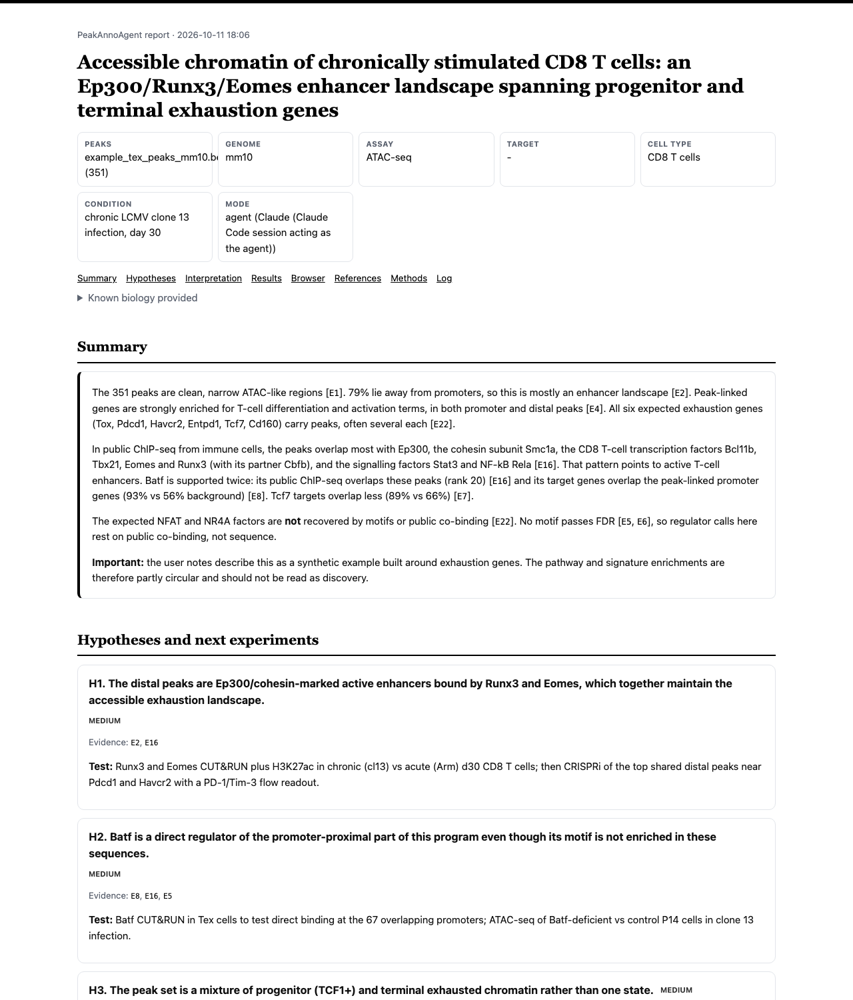
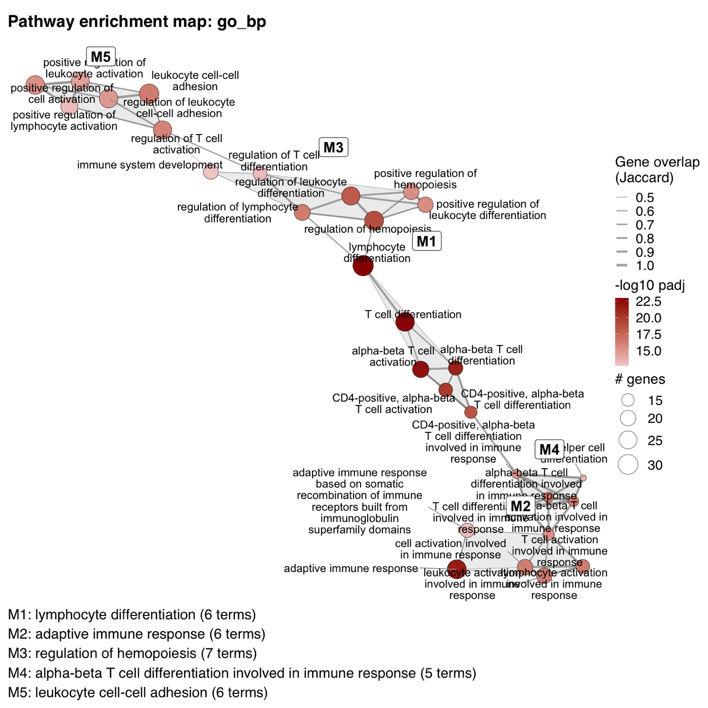
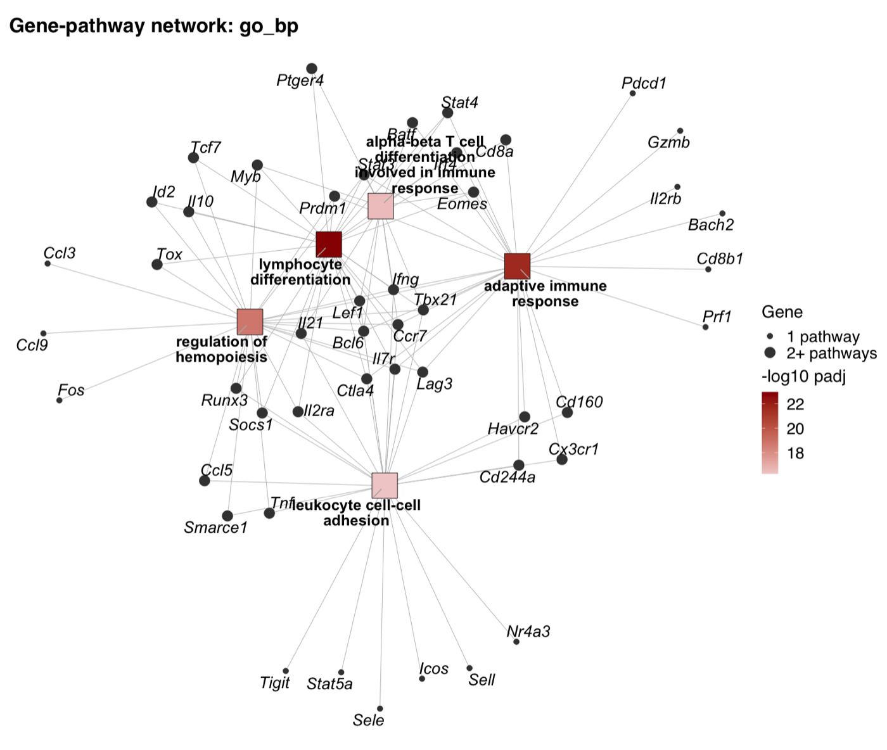
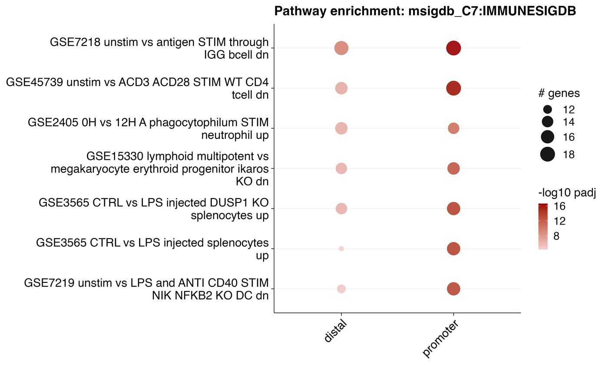
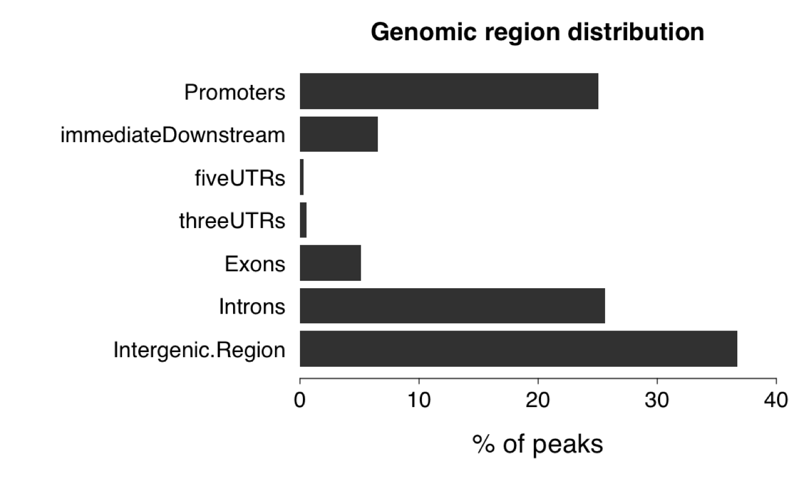

PeakAnnoAgent
From a peak file to an evidence-linked biological report: annotation, pathways, motifs, regulators and literature in one run.

<p align="left">
  <a href="LICENSE.md"></a>
  = 4.1" src="https://img.shields.io/badge/R-%E2%89%A5%204.1-276DC3.svg">
  = 3.10" src="https://img.shields.io/badge/python-%E2%89%A5%203.10-3776AB.svg">
  
  
</p>

**PeakAnnoAgent** annotates and interprets genomic peak sets from ChIP-seq, ATAC-seq, CUT&RUN or
CUT&Tag. You give it three things:

- a peak file;
- a reference genome;
- what you already know about the biology.

It runs a full Bioconductor workflow and searches public data and the literature. It then writes an
HTML report with testable hypotheses, in which **every statement links to the result it came from**.

You can run it in three ways:

- as an **LLM agent**, where Claude plans the analysis and interprets the results;
- as a **fixed, deterministic pipeline** that needs no API key;
- as a plain **R package**.

<p align="left">
  
</p>

## Highlights

| | What it does | Built on |
|---|---|---|
| **Peak QC** | Duplicates, non-standard contigs, blacklist removal, width and chromosome checks | data.table |
| **Annotation** | Nearest gene, bidirectional promoters, genomic-region distribution, TSS profiles | ChIPpeakAnno, ChIPseeker, rGREAT, HOMER |
| **Pathways** | GO, KEGG, Reactome, MSigDB (Hallmark, ImmuneSigDB, …) and your own GMT signatures, against a genome background | clusterProfiler, ReactomePA, msigdbr |
| **Pathway networks** | Enrichment maps with pathway modules, gene–pathway networks with hub genes, Cytoscape-ready tables | igraph, ggplot2 |
| **Motifs** | Known-motif enrichment against a GC-matched background, genome-wide or distal-only | monaLisa + JASPAR 2024, HOMER |
| **Regulators** | Co-binding with every public ChIP-seq/ATAC-seq experiment, and overlap with known TF targets | ChIP-Atlas |
| **Your biology** | Positive-control genes and TFs, RNA-seq integration, assay-aware settings | — |
| **Context** | Related papers and public datasets | Europe PMC, NCBI GEO |
| **Report** | Self-contained HTML: summary, hypotheses with next experiments, figures, tables, igv.js browser, Methods with package versions | — |

All figures follow Nature's artwork guidelines. Each is a vector PDF with editable Helvetica text,
ready for Illustrator.

## Installation

PeakAnnoAgent has two parts:

- an **R engine**, which does all the statistics and draws the figures;
- a **Python agent**, which plans the analysis, calls public resources and writes the report.

```bash
git clone https://github.com/helenhuangmath/PeakAnnoAgent.git
cd PeakAnnoAgent

# 1. R engine: Bioconductor packages for annotation, enrichment and motifs
Rscript scripts/install_dependencies.R

# 2. Python agent
pip install -e "agent[agent]"    # Claude agent mode (Anthropic SDK)
pip install -e "agent[mcp]"      # optional: use from Claude Code / Claude Desktop

# 3. Check that everything is found
peakanno-agent check --genome mm10
```

To install only the R package:

```r
# install.packages("remotes")
remotes::install_github("helenhuangmath/PeakAnnoAgent")
```

<details>
<summary><b>Requirements and optional tools</b></summary>

- **R ≥ 4.1** with Bioconductor. `install_dependencies.R` installs:
  - ChIPpeakAnno, ChIPseeker, clusterProfiler, ReactomePA, msigdbr, monaLisa, JASPAR2024 and igraph;
  - the TxDb, OrgDb and BSgenome packages for mm10 and hg38.
- **Python ≥ 3.10** for agent mode. With `--no-llm`, only the standard library is needed (Python ≥ 3.9).
- **Claude API access** for agent mode. Set `ANTHROPIC_API_KEY`.
- **Optional:**
  - [HOMER](http://homer.ucsd.edu/homer/), with `findMotifsGenome.pl` on `PATH`;
  - `rGREAT`, for region-based enrichment.
- If your Bioconductor packages live in a different R installation, set `PEAKANNOAGENT_RSCRIPT=/path/to/Rscript`.

</details>

## Quick start

The repository includes a small synthetic example: 351 ATAC-seq peaks from exhausted-like CD8 T cells
on mm10. It comes with known biology, exhaustion gene signatures and an RNA-seq table.

```bash
peakanno-agent run \
  --peaks examples/data/example_tex_peaks_mm10.bed --genome mm10 \
  --biology-file examples/data/example_tex_biology.json \
  --gmt examples/data/example_tex_signatures.gmt \
  --rnaseq examples/data/example_tex_rnaseq_de.tsv \
  --out results/tex --prefix tex

open results/tex/tex_report.html
```

### Tell it what you know

The known biology changes the analysis, not just the text of the report:

```bash
peakanno-agent run --peaks peaks.bed --genome mm10 --out results/run1 \
  --assay "ATAC-seq" --cell-type "CD8 T cells" --condition "chronic LCMV" \
  --expected-genes Tox,Pdcd1,Havcr2 --expected-tfs Nfatc1,Batf \
  --biology "Exhaustion is driven by TOX/NR4A downstream of persistent TCR signalling."
```

What it changes:

- The promoter window adapts to the assay.
- Broad histone marks skip motif scanning.
- Enhancer assays get a distal-only motif scan.
- Gene-set collections are chosen for the cell type.
- Expected genes and TFs become positive controls.
- Literature and GEO searches are built around your system.

You can give the same fields as a JSON file (`--biology-file`) or as free-text notes.

### Choose a mode

| Mode | Command | Needs |
|---|---|---|
| **Agent**: Claude plans, runs tools and interprets | `peakanno-agent run …` | `ANTHROPIC_API_KEY` |
| **Deterministic**: fixed plan with a factual summary | `peakanno-agent run … --no-llm` | nothing |
| **Offline**: no ChIP-Atlas, Europe PMC or GEO calls | add `--offline` | nothing |
| **Claude Code / Desktop as the agent** | `claude mcp add peakanno -- python -m peakannoagent.mcp_server` | MCP |

### Use the R engine directly

Every agent tool is also an R function:

```r
library(PeakAnnoAgent)

anno <- run_agent_tool("annotate_peaks", list(
  peaks = "peaks.bed", genome = "mm10", out_dir = "results/r", prefix = "tex"))

enr <- run_agent_tool("enrich_pathways", list(
  gene_sets = anno$gene_sets, universe = anno$universe, genome = "mm10",
  methods = c("go_bp", "msigdb_H"), out_dir = "results/r", prefix = "tex"))

mot <- run_agent_tool("find_motifs", list(
  peaks = "peaks.bed", genome = "mm10", out_dir = "results/r", prefix = "tex"))

enr$pathway_modules$go_bp     # pathway modules from the enrichment map
```

Individual steps also run from the command line (`Rscript scripts/peak_agent.R --help`); see the
[R command-line reference](docs/r_cli.md).

## Example output

These figures come from the bundled example, analysed by the agent. The pathway analysis is deterministic, so the same methods give the same figures.

<table>
  <tr>
    <td width="50%"><br>
      <sub><b>Pathway enrichment map.</b> GO terms are linked by shared genes and grouped into modules (M1–M5).</sub></td>
    <td width="50%"><br>
      <sub><b>Gene–pathway network.</b> Module-lead pathways and their genes; genes shared by several pathways are hubs.</sub></td>
  </tr>
  <tr>
    <td><br>
      <sub><b>Signature enrichment</b> (MSigDB ImmuneSigDB) in promoter vs distal peaks.</sub></td>
    <td><br>
      <sub><b>Genomic distribution</b> of peaks (ChIPpeakAnno).</sub></td>
  </tr>
</table>

Each run writes:

| Output | Content |
|---|---|
| `<prefix>_report.html` | Self-contained report: summary, hypotheses, interpretation, every result with figures and tables, genome browser, references, Methods, analysis log |
| `results/*.pdf` | Every figure as a publication-ready vector PDF |
| `results/*.tsv` | Every table (annotation, enrichment, network nodes and edges, motifs, ChIP-Atlas, RNA-seq overlap) |
| `<prefix>_evidence.json` | Every tool result with its evidence ID, papers and datasets |
| `<prefix>_manifest.json` | Parameters, timing, model usage, unverified citations |

## How it works

```text
           peaks + genome + known biology
                          │
                ┌─────────▼─────────┐        Claude plans the analysis, chooses
                │  Python agent     │◄──────  settings, and interprets results
                │  (agent/)         │        (or a fixed plan with --no-llm)
                └──┬──────────┬─────┘
       JSON bridge │          │ HTTPS
     ┌─────────────▼───┐   ┌──▼──────────────────────────────┐
     │ R engine (R/)   │   │ ChIP-Atlas · Europe PMC · GEO    │
     │ QC, ChIPpeakAnno│   └─────────────────────────────────┘
     │ enrichment,     │
     │ networks, motifs│
     └────────┬────────┘
              ▼
   evidence store (E1, E2, …) ──► HTML report with checked citations
```

**Why you can trust the report**

- **Statistics come only from the tools.** The model never computes them.
- **Citations are checked.** Every tool result gets an evidence ID (`E1`, `E2`, …). The report may cite
  only those IDs, and PMIDs or accessions actually retrieved in this run. Any other citation is sent back
  to the model once, and if it remains it is struck through in the report.
- **Inputs stay data.** Your notes, paper abstracts and GEO text are passed as data, never as
  instructions.
- **Failures are reported, not hidden.** A failed or skipped step appears in the report with its error,
  and the run continues.

## Supported genomes

`mm10`, `mm39`, `hg38` and `hg19` (`mouse` and `human` also work). You can use another annotation
database by setting `--txdb` and `--orgdb` in the R command line.

## Documentation

- [Agent guide](agent/README.md): modes, outputs, guardrails, MCP setup
- [Methods](docs/methods.md): statistical methods and the reporting standard
- [Agent design](docs/agent_design.md): architecture and tool contracts
- [R command-line reference](docs/r_cli.md): every R step as a standalone command
- [Vignette](vignettes/peak-annotation-workflow.Rmd): R workflow walkthrough

## Testing

```bash
Rscript tests/run_tests.R                                  # R engine
cd agent && python -m unittest discover -s tests           # Python agent
```

## License

[MIT](LICENSE.md) 
@ 2026 Hua Huang

PeakAnnoAgent depends on many open-source Bioconductor and CRAN packages, and on public resources
(ChIP-Atlas, Europe PMC, NCBI GEO, JASPAR, MSigDB). Each has its own license and terms of use. MSigDB
gene sets in particular are under their own license from the Broad Institute and UC San Diego.
