# PeakAnnoAgent

**PeakAnnoAgent is an AI agent that turns a ChIP-seq, ATAC-seq, CUT&RUN or CUT&Tag peak file into an
evidence-linked biological report: annotation, pathways, motifs, regulators and literature in one run.**

**Web page:** start it with `peakanno-agent web --open`, then open
[http://127.0.0.1:8766](http://127.0.0.1:8766) to upload peaks and run the analysis in your browser
([details](#run-it-in-your-browser)).

You give it three things:

- a peak file;
- a reference genome;
- what you already know about the biology.

It annotates the peaks, runs pathway and motif enrichment, and searches public data and the literature. It then writes an
HTML report with testable hypotheses, in which **every statement links to the result it came from**.

You can run it in four ways:

- as a **web app**, where you upload peaks, watch the agent work, then search the results and ask Claude about them;
- as an **LLM agent** from the command line, where Claude plans the analysis and interprets the results;
- as a **fixed, deterministic pipeline** that needs no API key;
- as a **fast annotator** only (`peakanno-agent annotate`), from the command line, Python or R.

<p align="left">
  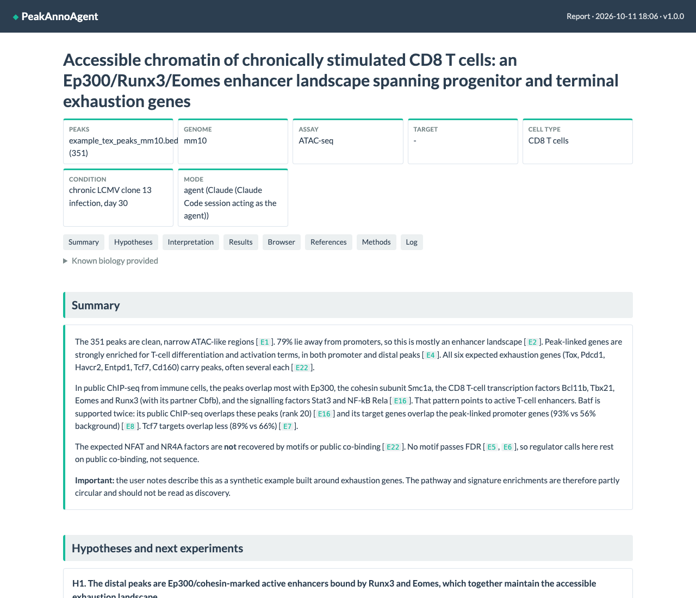
</p>

## Run it in your browser

PeakAnnoAgent runs on your own computer; the web app is a local page, not a hosted service. Start it
with one command, then open the run page:

```bash
peakanno-agent web --open
```

**Run page: [http://127.0.0.1:8766](http://127.0.0.1:8766)** (works while the command above is running)

<p align="left">
  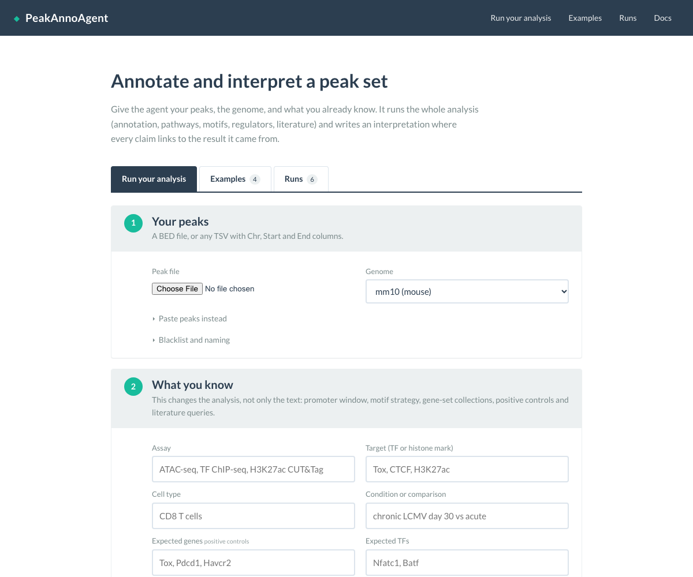
</p>

The page has three tabs: **Run your analysis**, **Examples** and **Runs**.
On the page you upload a peak file (or pick an example), choose the genome, and press **Run**. See
[Installation](#installation) to get the `peakanno-agent` command, and [Use the web app](#use-the-web-app)
for what the page offers.

With Docker, nothing else needs to be installed:

```bash
git clone https://github.com/helenhuangmath/PeakAnnoAgent.git && cd PeakAnnoAgent
docker build -t peakannoagent .
docker run --rm -p 127.0.0.1:8766:8766 -v "$PWD/runs:/work/runs" \
  -e ANTHROPIC_API_KEY peakannoagent web --host 0.0.0.0
```

Then open the same run page. `ANTHROPIC_API_KEY` is only needed for agent mode and the chat.

## Highlights

| | What it does | Built on |
|---|---|---|
| **Peak QC** | Duplicates, non-standard contigs, blacklist removal, width and chromosome checks | built in |
| **Annotation** | About a second for 100,000 peaks, against GENCODE, RefSeq, UCSC or any GTF: genomic feature per peak, nearest gene, bidirectional and alternative promoters; feature pie chart, feature bar, distance-to-TSS, upset, region distribution, TSS profile and chromosome coverage figures | built in |
| **Pathways** | GO, KEGG, Reactome, WikiPathways, Hallmark, ImmuneSigDB, cell types, TF targets and your own GMT signatures, against a genome background | built in; gene sets from MSigDB and Enrichr |
| **Pathway networks** | Enrichment maps with pathway modules, gene–pathway networks with hub genes, Cytoscape-ready tables; EnrichmentMap/AutoAnnotate-style clustered networks with interactive HTML | built in, [SimpNetworkViz](https://github.com/helenhuangmath/SimpNetworkViz) |
| **Pathway consensus** | The same gene lists through several independent engines, combined into consensus themes with tiers and key driver genes | [PathwayAgent](https://github.com/helenhuangmath/PathwayAgent) |
| **Motifs** | Known-motif enrichment, genome-wide or distal-only (optional) | HOMER |
| **Regulators** | Co-binding with every public ChIP-seq/ATAC-seq experiment, and overlap with known TF targets | ChIP-Atlas |
| **Your biology** | Positive-control genes and TFs, RNA-seq integration, assay-aware settings | — |
| **Context** | Related papers and public datasets | Europe PMC, NCBI GEO |
| **Report** | Self-contained HTML: summary, hypotheses with next experiments, figures, tables, igv.js browser, Methods | — |

All figures follow Nature's artwork guidelines. Each is a vector PDF with editable Helvetica text,
ready for Illustrator.

## Installation

PeakAnnoAgent is one Python package. It needs Python 3.10 or later, NumPy and Matplotlib; there is no
R or Bioconductor dependency.

```bash
git clone https://github.com/helenhuangmath/PeakAnnoAgent.git
cd PeakAnnoAgent
pip install -e .                 # annotation, enrichment, the deterministic pipeline
pip install -e ".[agent]"        # Claude agent mode (Anthropic SDK)
pip install -e ".[web]"          # web app (Flask)
pip install -e ".[mcp]"          # optional: use from Claude Code / Claude Desktop

peakanno-agent check             # what was found
```

Gene models and gene-set libraries are downloaded the first time they are used (20-40 MB per genome
build) and cached in `~/.cache/peakannoagent`; set `PEAKANNOAGENT_CACHE` to move the cache.

<details>
<summary><b>Optional tools</b></summary>

- **Claude API access** for agent mode and the chat. Set `ANTHROPIC_API_KEY`.
- [HOMER](http://homer.ucsd.edu/homer/) with its genome package, and `findMotifsGenome.pl` on `PATH`,
  for motif enrichment. Without it the motif step is skipped.
- [SimpNetworkViz](https://github.com/helenhuangmath/SimpNetworkViz) (`pip install git+https://github.com/helenhuangmath/SimpNetworkViz`), for the clustered pathway networks.
- [PathwayAgent](https://github.com/helenhuangmath/PathwayAgent), cloned next to this repository with its `.venv` set up, or `PEAKANNOAGENT_PATHWAYAGENT` pointing at its command, for the cross-tool pathway consensus.
- Steps whose tool is missing are reported as skipped; `peakanno-agent check` shows what was found.

</details>

<details>
<summary><b>Calling it from R</b></summary>

A small R package in [r/PeakAnnoAgent](r/PeakAnnoAgent) wraps the command line, for people who
work in R. It runs the Python program and returns its tables as data frames; it does no analysis
itself and has no Bioconductor dependency.

```r
# install.packages("remotes")
remotes::install_github("helenhuangmath/PeakAnnoAgent", subdir = "r/PeakAnnoAgent")
library(PeakAnnoAgent)
res <- annotate_peaks("peaks.bed", genome = "hg38", reference = "gencode")
head(res$annotation)
```

</details>

## Quick start

The repository includes a small synthetic example: 351 ATAC-seq peaks from exhausted-like CD8 T cells
on mm10. It comes with known biology, exhaustion gene signatures and an RNA-seq table.

```bash
peakanno-agent run \
  --peaks peakannoagent/examples/example_tex_peaks_mm10.bed --genome mm10 \
  --biology-file peakannoagent/examples/example_tex_biology.json \
  --gmt peakannoagent/examples/example_tex_signatures.gmt \
  --rnaseq peakannoagent/examples/example_tex_rnaseq_de.tsv \
  --out results/tex --prefix tex

open results/tex/tex_report.html
```

### Tell it what you know

The known biology changes the analysis, not just the text of the report:

```bash
peakanno-agent run --peaks peaks.bed --genome mm10 --out results/run1 \
  --assay "ATAC-seq" --cell-type "CD8 T cells" --condition "chronic LCMV" \
  --expected-genes Tox,Pdcd1,Havcr2 --expected-tfs Nfatc1,Batf \
  --biology "Exhaustion is driven by TOX/NR4A downstream of persistent TCR signalling."
```

What it changes:

- The promoter window adapts to the assay.
- Broad histone marks skip motif scanning.
- Enhancer assays get a distal-only motif scan.
- Gene-set collections are chosen for the cell type.
- Expected genes and TFs become positive controls.
- Literature and GEO searches are built around your system.

You can give the same fields as a JSON file (`--biology-file`) or as free-text notes.

### Use the web app

```bash
peakanno-agent web --open          # http://127.0.0.1:8766, runs are written to ./runs
```

The home page is a three-step form: your peaks, what you know, how to run. The run page shows the
analysis in separate parts, with a sidebar to move between them:

| Part | What it shows |
|---|---|
| **Overview** | Key numbers (peaks, promoter fraction, enriched gene sets, motifs, co-binding factors, positive controls), the biology you gave, and the agent's step-by-step plan with its reasons |
| **Summary · Interpretation** | The agent's reading, then key results grouped by topic (peaks, pathways, motifs, regulators, expression, literature), then caveats; every claim carries an evidence badge that opens the matching result card |
| **Suggestions** | After the Regulators part: the agent's testable hypotheses, each with confidence, evidence and the experiment that would test it |
| **Peaks & annotation · Pathways · Motifs · Regulators · Expression & controls · Literature & data** | One card per analysis step: key statistics, top-term tables, figures (PNG and PDF downloads), downloadable tables, warnings. The Pathways card opens with an **interactive explorer**: a clickable top-terms chart, a draggable pathway network (enrichment map, coloured by module) and a gene–pathway map. Click a pathway to list its genes; click a gene to see its pathways, peaks and expression and to search the run. Each view downloads as SVG, PNG or TSV. The part also holds the SimpNetworkViz clustered network and the PathwayAgent consensus themes |
| **Search results** | One box over genes (with their peaks, pathways, RNA-seq direction, control status), peak ids, pathways, motifs, ChIP-Atlas regulators, papers, datasets and hypotheses |
| **Ask Claude** | A chat about *this* run. Claude has read-only tools (search the run, look a gene up, read any table, Europe PMC, GEO) and cites evidence ids; unverified citations are flagged, as in the report |
| **Methods · Analysis log** | Auto-written methods with package versions, and the full tool trace |

While a run is in progress the page streams the log and updates itself when the results are ready.
The self-contained HTML report is still written and linked from the top of the page, next to
**Download all**, a zip of the report, the evidence file and every table and figure. The report carries
the same interactive pathway explorer, with the data embedded, so it works offline.

**Examples.** The home page offers four example peak sets. Each card has **Run** (start the analysis
as is, in one click) and **Edit first** (fill the form with its peaks and biology so you can change
them), and a link to download the BED file:

| Example | Genome | Peaks | Source |
|---|---|---|---|
| Exhausted CD8 T cells, ATAC-seq (with signatures and RNA-seq) | mm10 | 351 | Synthetic, `examples/scripts/make_example_tex_peaks.R` |
| CTCF ChIP-seq, K562 | hg38 | 1000 strongest | ENCODE ENCSR000BPJ, file ENCFF582SNT (IDR thresholded peaks) |
| H3K27ac ChIP-seq, human CD8 T cells | hg38 | 1000 strongest | ENCODE ENCSR835OJV, file ENCFF283CAQ (replicated peaks) |
| H3K4me3 ChIP-seq, mouse bone-marrow macrophages | mm10 | 800 strongest | ENCODE ENCSR916IRY, file ENCFF813FPW (replicated peaks) |

The ENCODE sets are real data with a known answer (the CTCF motif should dominate; H3K4me3 should sit
on promoters), so they are a good check that the installation works. The two demo results under
`docs/demo/` are listed automatically, so the run page, search and chat can be explored before R or an
API key is set up.

Finished runs from the command line can be opened in the app too (*Open an existing result folder*).

<table>
  <tr>
    <td width="50%">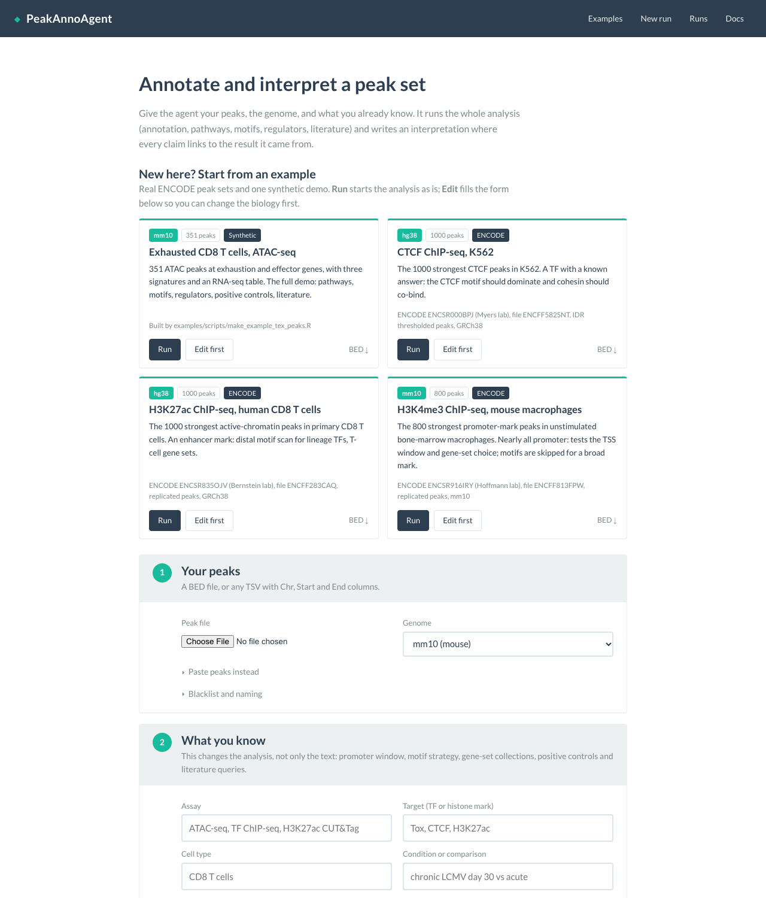<br><sub><b>Submit.</b> Peaks, what you know, how to run.</sub></td>
    <td width="50%">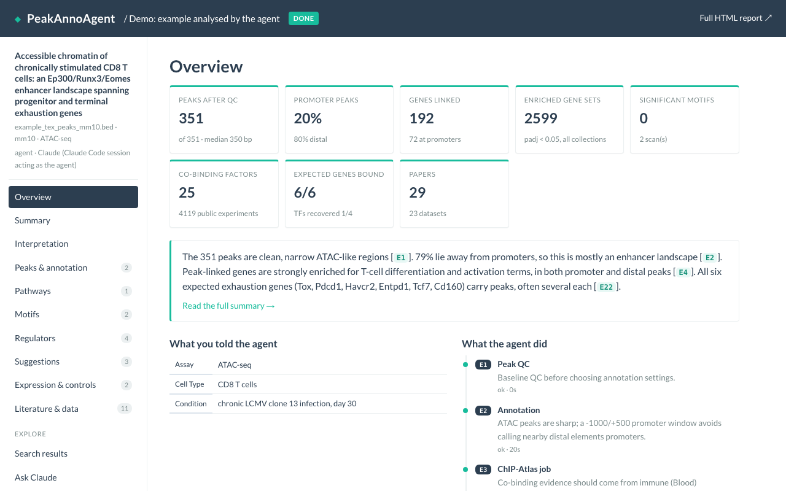<br><sub><b>Overview.</b> Key numbers, the lead of the summary, and what the agent did and why.</sub></td>
  </tr>
  <tr>
    <td width="50%">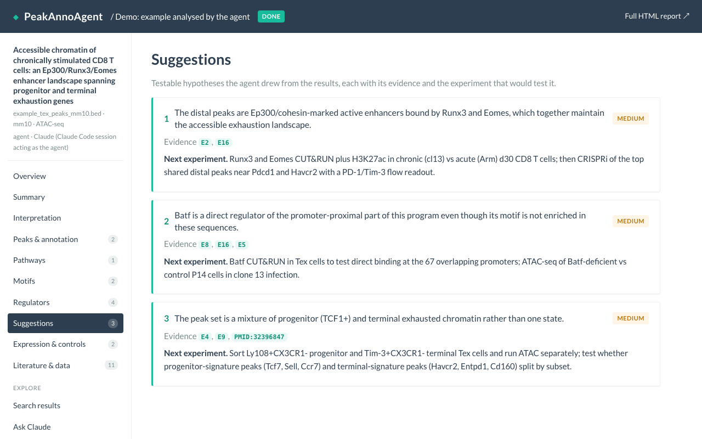<br><sub><b>Suggestions.</b> Each with confidence, evidence badges and a next experiment.</sub></td>
    <td width="50%">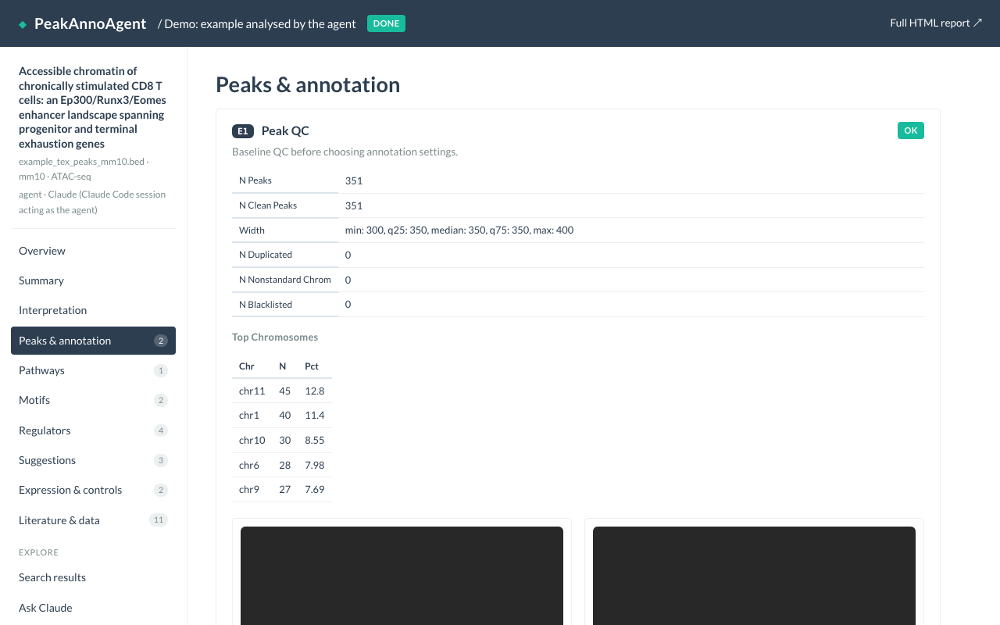<br><sub><b>Result cards.</b> Statistics, figures and tables per step.</sub></td>
  </tr>
  <tr>
    <td width="50%">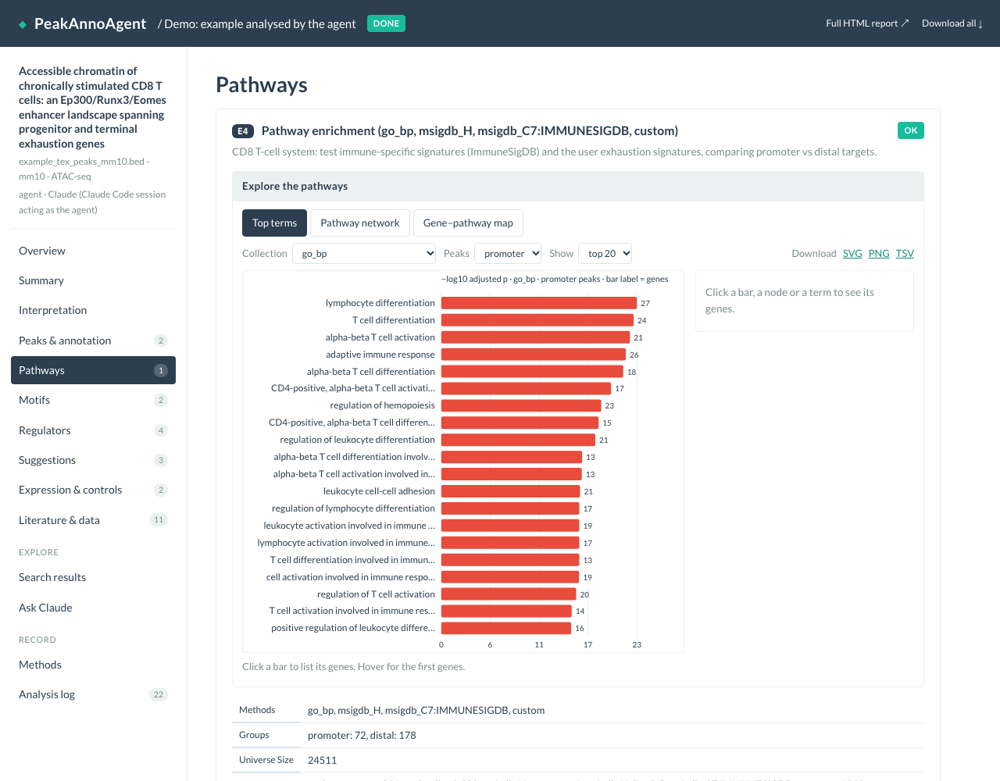<br><sub><b>Pathway explorer.</b> Clickable top terms, a draggable pathway network and a gene–pathway map; click a pathway for its genes, a gene for its pathways. Downloads as SVG, PNG or TSV.</sub></td>
    <td width="50%">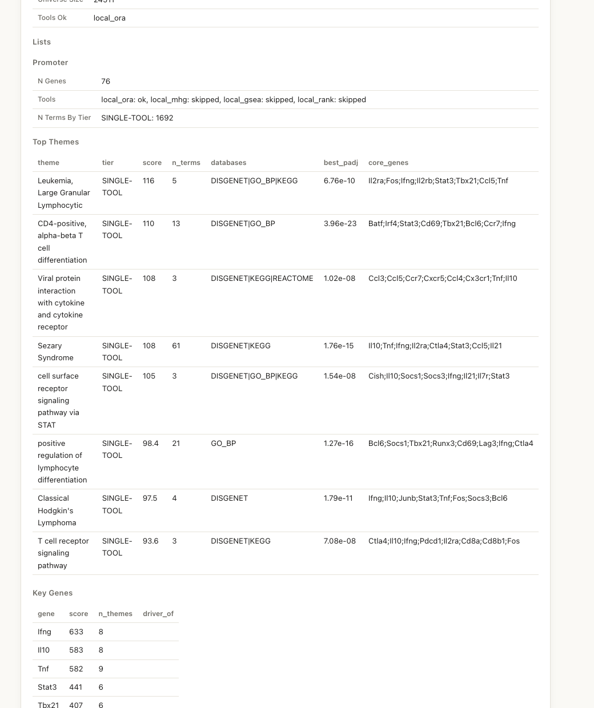<br><sub><b>Pathway consensus.</b> PathwayAgent themes, tiers and key genes per gene list.</sub></td>
  </tr>
  <tr>
    <td width="50%">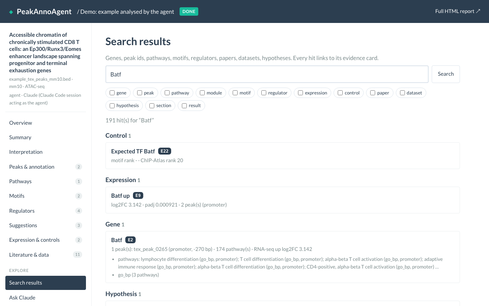<br><sub><b>Search.</b> "Batf" across controls, expression, genes, hypotheses and motifs.</sub></td>
    <td width="50%">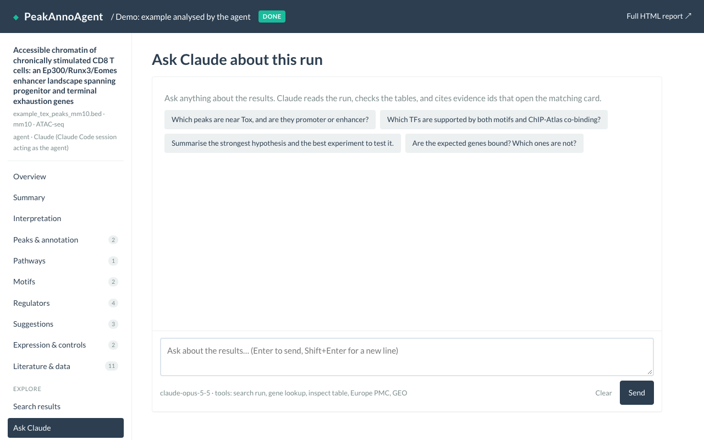<br><sub><b>Ask.</b> Questions about the run, answered with cited evidence.</sub></td>
  </tr>
</table>

### Choose a mode

| Mode | Command | Needs |
|---|---|---|
| **Web app**: form, live log, report, search, chat | `peakanno-agent web` | Flask; `ANTHROPIC_API_KEY` for agent mode and chat |
| **Agent**: Claude plans, runs tools and interprets | `peakanno-agent run …` | `ANTHROPIC_API_KEY` |
| **Deterministic**: fixed plan with a factual summary | `peakanno-agent run … --no-llm` | nothing |
| **Offline**: no ChIP-Atlas, Europe PMC or GEO calls | add `--offline` | nothing |
| **Claude Code / Desktop as the agent** | `claude mcp add peakanno -- python -m peakannoagent.mcp_server` | MCP |

### Annotate only

`annotate` runs just the annotation: no agent, no enrichment, no report. It takes about a second once
the gene models are cached.

```bash
peakanno-agent annotate --peaks peaks.bed --genome hg38 --out results/anno
```

It writes the per-peak table, the feature and region distributions, the gene sets, and eight figures
(see [Example output](#example-output)), and prints the feature breakdown.

### Gene models

Gene models are parsed once, cached, and then peaks are annotated with array lookups. Choose the gene
models per run, for `run` and `annotate` alike:

```bash
peakanno-agent annotate --peaks peaks.bed --genome hg38 --out results                           # GENCODE v46 basic (default)
peakanno-agent annotate --peaks peaks.bed --genome mm10 --out results --reference gencode:vM25  # a chosen release
peakanno-agent annotate --peaks peaks.bed --genome hg38 --out results --reference refseq        # NCBI RefSeq
peakanno-agent annotate --peaks peaks.bed --genome hg38 --out results --reference ucsc          # UCSC knownGene
peakanno-agent annotate --peaks peaks.bed --genome hg38 --out results --gtf my_annotation.gtf.gz
peakanno-agent annotate --peaks peaks.bed --genome hg38 --out results --palette spectral        # figure colours (default: chippeakanno)
```

The web form has the same choice under **Gene annotation**. Peaks are annotated against
protein-coding genes by default; `--gene-types all` includes lncRNAs and pseudogenes.

### Use it from Python

```python
from peakannoagent import build_reference, read_peak_file, annotate_peaks, run_annotation

ref   = build_reference("hg38", "gencode")
peaks = read_peak_file("peaks.bed")
table = annotate_peaks(peaks, ref)                       # dict of columns, one row per peak
res   = run_annotation(peaks, "results/py", "run", genome="hg38", reference=ref)   # tables + figures
```

## Demo: with and without the agent

> The two demo reports below were generated with version 1.0.2, when the analysis ran in R. The
> report layout is the same today; annotation file names, the motif backend and the Methods text
> differ. Run the example yourself to see current output.

The same 351 example peaks were run twice: once with Claude as the agent, and once with `--no-llm`.
Historical example runs are bundled under [docs/demo/](docs/demo/), so you can explore the reports without
running anything. These pre-1.0.2 outputs illustrate the interface; re-run them with 1.0.2 before using
quantitative annotation or overlap results.

| | With agent | Without agent (`--no-llm`) |
|---|---|---|
| **Report** | [open in browser](https://raw.githack.com/helenhuangmath/PeakAnnoAgent/main/docs/demo/with_agent/tex_report.html) · [file](docs/demo/with_agent/tex_report.html) | [open in browser](https://raw.githack.com/helenhuangmath/PeakAnnoAgent/main/docs/demo/without_agent/tex_report.html) · [file](docs/demo/without_agent/tex_report.html) |
| **Evidence** | [tex_evidence.json](docs/demo/with_agent/tex_evidence.json) | [tex_evidence.json](docs/demo/without_agent/tex_evidence.json) · [tex_manifest.json](docs/demo/without_agent/tex_manifest.json) |
| **Figures and tables** | [results/](docs/demo/with_agent/results/) | [results/](docs/demo/without_agent/results/) |
| **Needs** | `ANTHROPIC_API_KEY` | nothing |
| **Plan** | Claude chooses steps and settings from the known biology (22 steps) | Fixed plan with default settings (12 steps) |
| **Promoter window** | −1000/+500 bp, chosen for sharp ATAC peaks | −2000/+500 bp default |
| **Gene sets** | GO BP, Hallmark, **ImmuneSigDB** (CD8 T-cell system) and the user's exhaustion signatures, promoter vs distal | GO BP, **KEGG**, Hallmark and the user's signatures, all/promoter/distal |
| **Motifs** | Distal-only scan first (79 % of peaks are distal), then all peaks | All peaks, then distal |
| **Regulators** | ChIP-Atlas co-binding restricted to immune (Blood) experiments; Tcf7 and Batf target-gene overlap tests | ChIP-Atlas co-binding, all cell classes |
| **Literature** | Nine targeted queries (TOX, NR4A, TCF1, BATF, exhaustion chromatin), re-queried by citations when the first pass returned only reviews | One generic query built from the biology fields |
| **Summary** | Titled narrative: what the peaks are, pathways, candidate regulators, caveats | Automated bullet list of key statistics |
| **Hypotheses** | Three, each with evidence IDs and a proposed next experiment | None |
| **Statistics** | Identical: computed by the R engine in both modes | Identical |

### With agent

```bash
peakanno-agent run \
  --peaks peakannoagent/examples/example_tex_peaks_mm10.bed --genome mm10 \
  --biology-file peakannoagent/examples/example_tex_biology.json \
  --gmt peakannoagent/examples/example_tex_signatures.gmt \
  --rnaseq peakannoagent/examples/example_tex_rnaseq_de.tsv \
  --out results/demo_agent --prefix tex
```

<p align="left">
  <a href="docs/demo/with_agent/tex_report.html">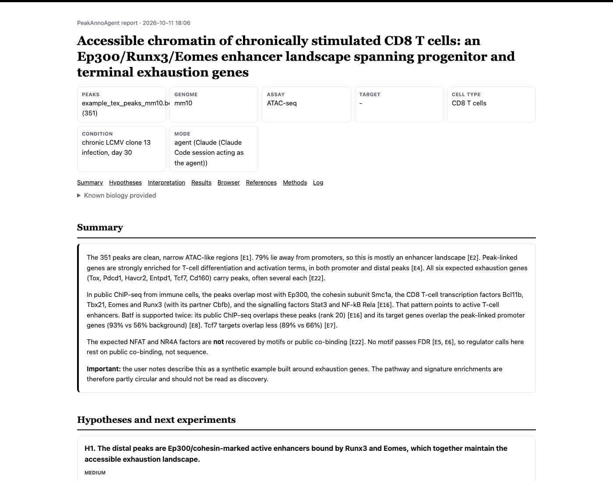</a>
</p>

<table>
  <tr>
    <td width="50%"><a href="docs/demo/with_agent/results/tex_enrich1_enrichment_msigdb_C7-IMMUNESIGDB_dotplot.pdf">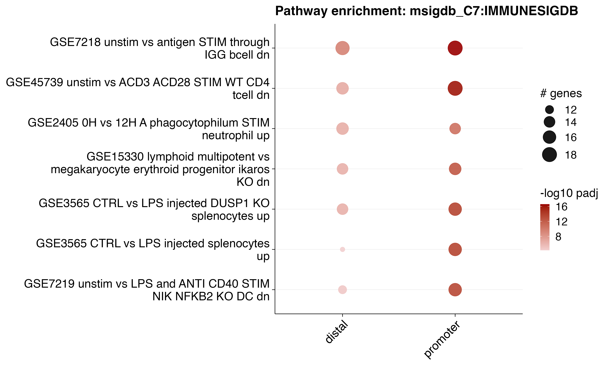</a><br>
      <sub><b>ImmuneSigDB.</b> The agent added this immune-specific collection because the cell type is CD8 T cells, and compared promoter with distal peaks.</sub></td>
    <td width="50%"><a href="docs/demo/with_agent/results/tex_enrich1_enrichment_custom_dotplot.pdf">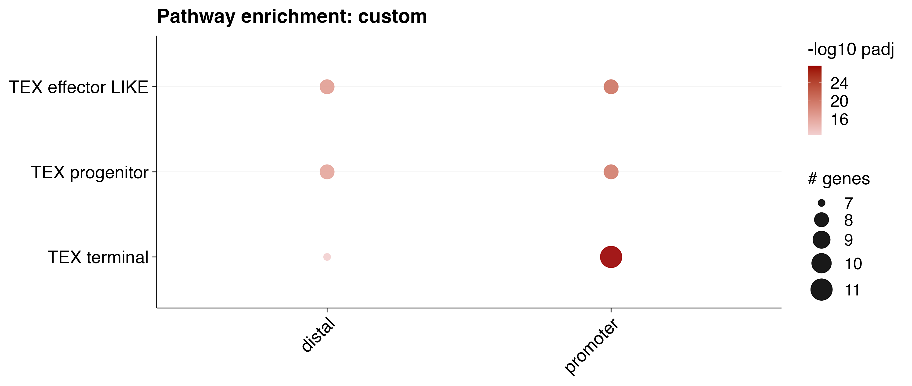</a><br>
      <sub><b>User signatures.</b> Terminal exhaustion is strongest at promoters; progenitor and effector-like signatures appear in both groups.</sub></td>
  </tr>
</table>

### Without agent

```bash
peakanno-agent run \
  --peaks peakannoagent/examples/example_tex_peaks_mm10.bed --genome mm10 \
  --biology-file peakannoagent/examples/example_tex_biology.json \
  --gmt peakannoagent/examples/example_tex_signatures.gmt \
  --rnaseq peakannoagent/examples/example_tex_rnaseq_de.tsv \
  --out results/demo_no_agent --prefix tex --no-llm
```

<p align="left">
  <a href="docs/demo/without_agent/tex_report.html">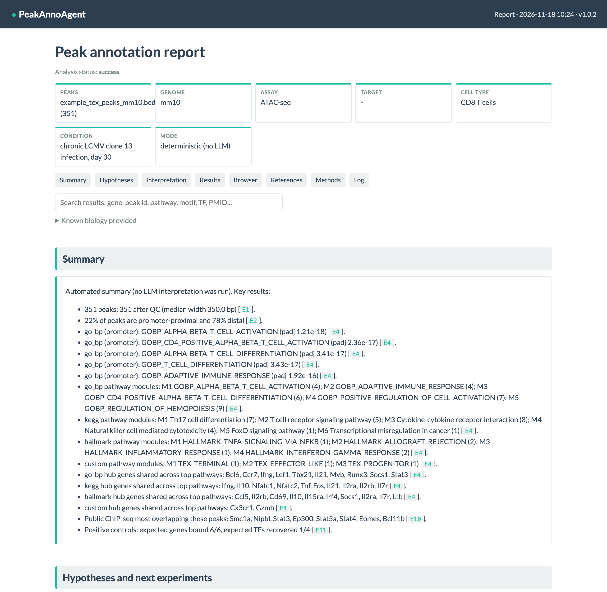</a>
</p>

<table>
  <tr>
    <td width="50%"><a href="docs/demo/without_agent/results/tex_enrich1_enrichment_kegg_dotplot.pdf">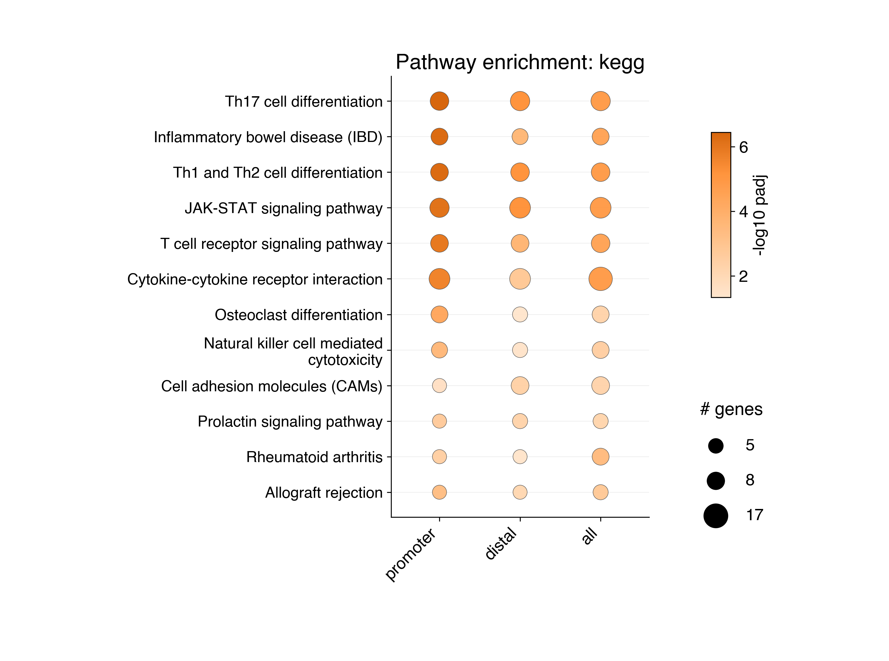</a><br>
      <sub><b>KEGG.</b> The fixed plan runs the default GO, KEGG and Hallmark collections for all, promoter and distal peaks.</sub></td>
    <td width="50%"><a href="docs/demo/without_agent/results/tex_enrich1_enrichment_custom_dotplot.pdf">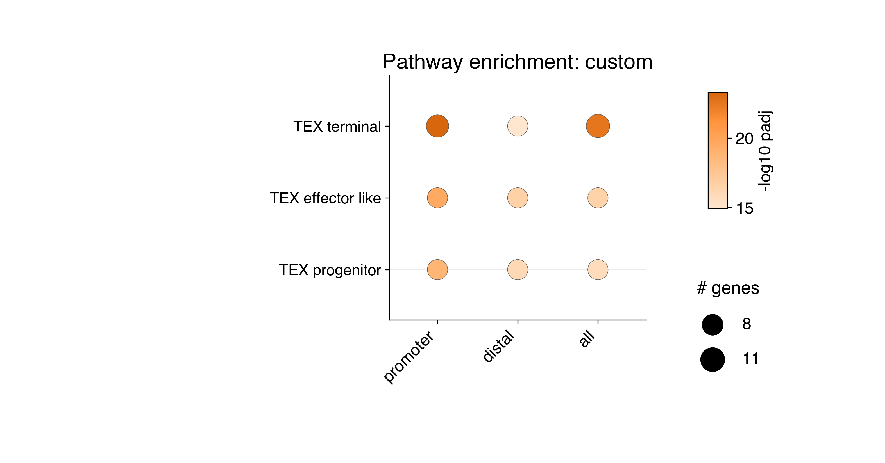</a><br>
      <sub><b>User signatures.</b> Same statistics as the agent run: the enrichment is computed by the R engine in both modes.</sub></td>
  </tr>
</table>

The pathway enrichment maps from the two runs differ only in module labels and layout
([with agent](docs/figures/demo/with_agent_enrichment_map.png),
[without agent](docs/figures/demo/without_agent_enrichment_map.png)); the underlying GO terms are the same.

> The browser links above point to the `main` branch and work once the demo folder is merged. On a
> clone, open the `tex_report.html` files directly; each report is self-contained and links its tables
> relative to its own folder.

## Example output

These figures come from the bundled example, analysed by the agent. The pathway analysis is deterministic, so the same methods give the same figures.

<table>
  <tr>
    <td width="50%">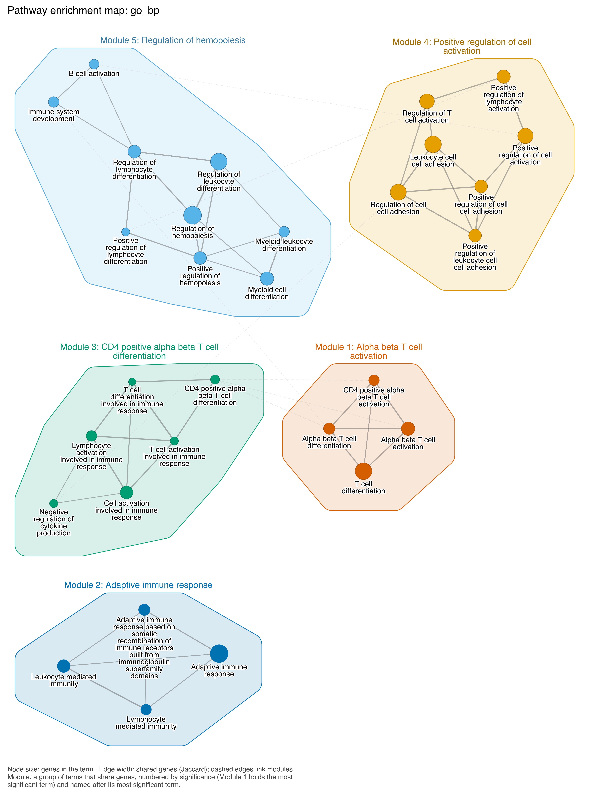<br>
      <sub><b>Pathway enrichment map.</b> GO terms are linked by shared genes and grouped into labelled modules (M1–M5), each in its own outline.</sub></td>
    <td width="50%">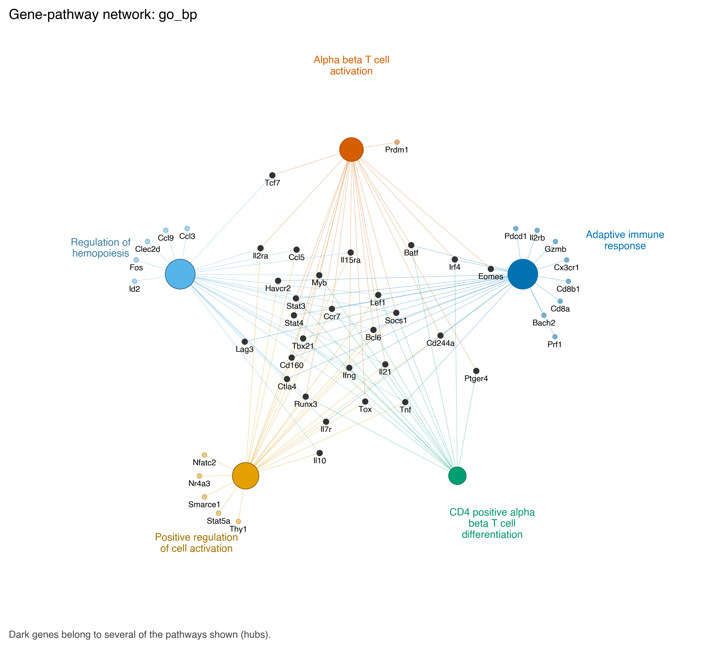<br>
      <sub><b>Gene–pathway network.</b> Module-lead pathways and their genes; genes shared by several pathways are hubs.</sub></td>
  </tr>
  <tr>
    <td><br>
      <sub><b>Signature enrichment</b> (your own gene signatures) in promoter vs distal peaks.</sub></td>
    <td>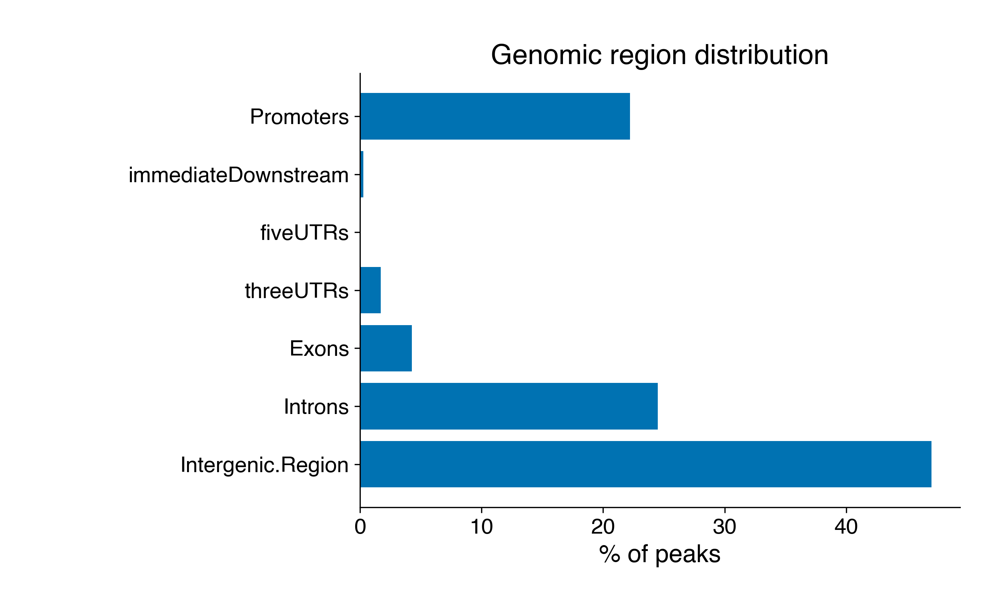<br>
      <sub><b>Genomic distribution</b> of peaks.</sub></td>
  </tr>
  <tr>
    <td>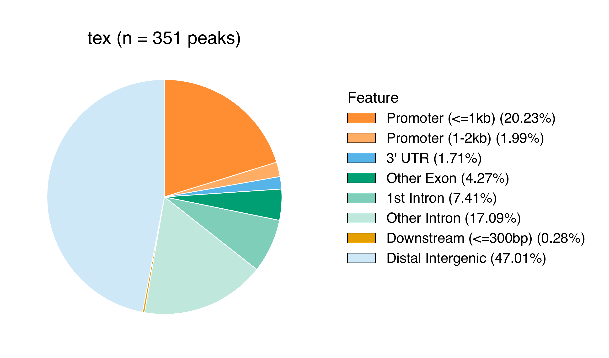<br>
      <sub><b>Feature types</b> of peaks: the share of peaks at promoters, UTRs, exons, introns, downstream and distal intergenic regions.</sub></td>
    <td>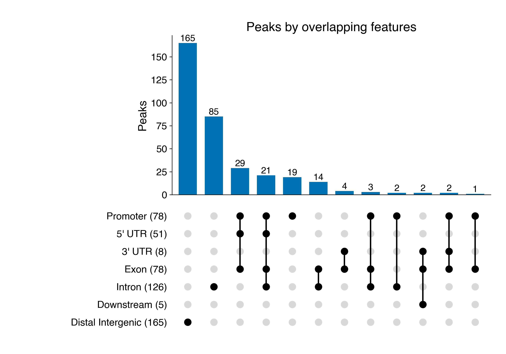<br>
      <sub><b>Feature overlaps.</b> Peaks by the combination of feature types they overlap.</sub></td>
  </tr>
</table>

Each run writes:

| Output | Content |
|---|---|
| `<prefix>_report.html` | Self-contained report: summary, hypotheses, interpretation, every result with figures and tables, genome browser, references, Methods, analysis log |
| `results/*.pdf` | Every figure as a publication-ready vector PDF |
| `results/*.tsv` | Every table (annotation, enrichment, network nodes and edges, motifs, ChIP-Atlas, RNA-seq overlap) |
| `<prefix>_evidence.json` | Every tool result with its evidence ID, papers and datasets |
| `<prefix>_manifest.json` | Parameters, timing, model usage, unverified citations |

## How it works

```text
           peaks + genome + known biology
                          │
                ┌─────────▼─────────┐        Claude plans the analysis, chooses
                │  agent            │◄──────  settings, and interprets results
                │                   │        (or a fixed plan with --no-llm)
                └──┬──────────┬─────┘
        in-process │          │ HTTPS
     ┌─────────────▼───┐   ┌──▼──────────────────────────────┐
     │ analysis engine │   │ ChIP-Atlas · Europe PMC · GEO    │
     │ QC, annotation, │   └─────────────────────────────────┘
     │ enrichment,     │
     │ networks, motifs│
     └────────┬────────┘
              ▼
   evidence store (E1, E2, …) ──► HTML report with checked citations
```

Everything is in one Python package: `peakannoagent.engine` does the analysis, and the rest plans,
calls public resources and writes the report.

**Why you can trust the report**

- **Statistics come only from the tools.** The model never computes them.
- **Citations are checked.** Every tool result gets an evidence ID (`E1`, `E2`, …). The report may cite
  only those IDs, and PMIDs or accessions actually retrieved in this run. Any other citation is sent back
  to the model once, and if it remains it is struck through in the report.
- **Inputs stay data.** Your notes, paper abstracts and GEO text are passed as data, never as
  instructions.
- **Failures are reported, not hidden.** A failed or skipped step appears in the report with its error,
  and the run continues.

## Supported genomes

`mm10`, `mm39`, `hg38` and `hg19` (`mouse` and `human` also work), with GENCODE, RefSeq, UCSC or
your own GTF gene models.

## Documentation

- [Documentation website](https://helenhuangmath.github.io/PeakAnnoAgent/) (source in [docs/site](docs/site/)):
  installation, gene models, subcommands, file formats, tutorials, Q & A and the API reference. Build it
  locally with `pip install -r docs/site/requirements.txt && sphinx-build -b html docs/site docs/site/_build/html`
- [Demo runs](docs/demo/): complete outputs of the example with and without the agent
- [Methods](docs/methods.md): statistical methods and the reporting standard
- [Agent design](docs/agent_design.md): architecture and tool contracts
- [R interface](r/PeakAnnoAgent): calling the program from R

## Run completion and reproducibility

Reports explicitly distinguish `success`, `partial`, and `failed`, with CLI exits 0, 3, and 1
respectively; invalid invocations return 2. QC and annotation must succeed; pathways,
assay-appropriate motifs, and supplied RNA-seq integration are also required for complete analysis.
Unavailable optional tools are recorded as skipped.

BED and `Chr/Start/End` TSV inputs use **zero-based, half-open** coordinates. Version 1.0.2 corrects
coordinate conversion and blacklist boundaries; re-run older analyses before quantitative use.
Manifests record input SHA-256 hashes and software versions. Use `peakanno-agent check --offline`
to verify local dependencies. See the [release guide](docs/release_1.0.2.md) for clean package,
container and full biological checks.

## Testing

```bash
python -m unittest discover -s tests            # engine, agent and web app
python scripts/smoke_install.py                 # an installed wheel, away from the checkout
```

## License and contact

PeakAnnoAgent is released under the [MIT License](LICENSE), © 2026 Hua Huang.

**Author and maintainer:** Hua Huang, University of Pennsylvania.
Contact: [helenhuang.math@gmail.com](mailto:helenhuang.math@gmail.com). Bug reports and feature
requests: [GitHub issues](https://github.com/helenhuangmath/PeakAnnoAgent/issues).
Version prepared: **1.1.0** (see [CHANGELOG.md](CHANGELOG.md)).

PeakAnnoAgent uses public resources (GENCODE, UCSC, NCBI RefSeq, MSigDB, Enrichr, ChIP-Atlas,
Europe PMC, NCBI GEO). Each has its own license and terms of use. MSigDB
gene sets in particular are under their own license from the Broad Institute and UC San Diego.
