# PeakAnnoAgent

From a peak file to an evidence-linked biological report: annotation, pathways, motifs, regulators and literature in one run.

**PeakAnnoAgent** annotates and interprets genomic peak sets from ChIP-seq, ATAC-seq, CUT&RUN or
CUT&Tag. You give it three things:

- a peak file;
- a reference genome;
- what you already know about the biology.

It runs a full Bioconductor workflow and searches public data and the literature. It then writes an
HTML report with testable hypotheses, in which **every statement links to the result it came from**.

You can run it in four ways:

- as a **web app**, where you upload peaks, watch the agent work, then search the results and ask Claude about them;
- as an **LLM agent** from the command line, where Claude plans the analysis and interprets the results;
- as a **fixed, deterministic pipeline** that needs no API key;
- as a plain **R package**.

<p align="left">
  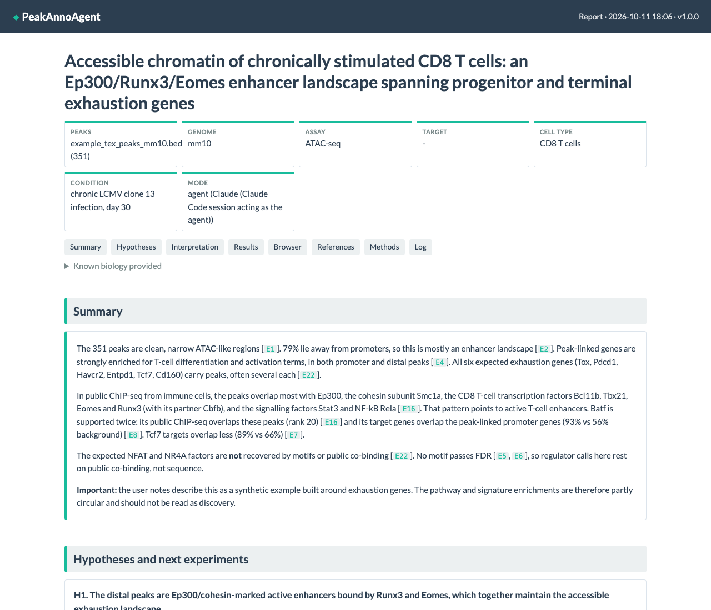
</p>

## Highlights

| | What it does | Built on |
|---|---|---|
| **Peak QC** | Duplicates, non-standard contigs, blacklist removal, width and chromosome checks | data.table |
| **Annotation** | Nearest gene, bidirectional promoters, genomic-region distribution, TSS profiles | ChIPpeakAnno, ChIPseeker, rGREAT, HOMER |
| **Pathways** | GO, KEGG, Reactome, MSigDB (Hallmark, ImmuneSigDB, …) and your own GMT signatures, against a genome background | clusterProfiler, ReactomePA, msigdbr |
| **Pathway networks** | Enrichment maps with pathway modules, gene–pathway networks with hub genes, Cytoscape-ready tables; EnrichmentMap/AutoAnnotate-style clustered networks with interactive HTML | igraph, ggplot2, [SimpNetworkViz](https://github.com/helenhuangmath/SimpNetworkViz) |
| **Pathway consensus** | The same gene lists through several independent engines (local ORA, and with network access Enrichr, g:Profiler, Reactome, STRING, clusterProfiler, fgsea), combined into consensus themes with tiers and key driver genes | [PathwayAgent](https://github.com/helenhuangmath/PathwayAgent) |
| **Motifs** | Known-motif enrichment against a GC-matched background, genome-wide or distal-only | monaLisa + JASPAR 2024, HOMER |
| **Regulators** | Co-binding with every public ChIP-seq/ATAC-seq experiment, and overlap with known TF targets | ChIP-Atlas |
| **Your biology** | Positive-control genes and TFs, RNA-seq integration, assay-aware settings | — |
| **Context** | Related papers and public datasets | Europe PMC, NCBI GEO |
| **Report** | Self-contained HTML: summary, hypotheses with next experiments, figures, tables, igv.js browser, Methods with package versions | — |

All figures follow Nature's artwork guidelines. Each is a vector PDF with editable Helvetica text,
ready for Illustrator.

## Installation

Built R and Python packages are available in the [v1.0.2 release](https://github.com/helenhuangmath/PeakAnnoAgent/releases/tag/v1.0.2). See [package installation and publishing](docs/package_distribution.md) for direct installation, local builds, PyPI and CRAN instructions.

PeakAnnoAgent has two parts:

- an **R engine**, which does all the statistics and draws the figures;
- a **Python agent**, which plans the analysis, calls public resources and writes the report.

```bash
git clone https://github.com/helenhuangmath/PeakAnnoAgent.git
cd PeakAnnoAgent

# 1. R engine: Bioconductor packages for annotation, enrichment and motifs
Rscript scripts/install_dependencies.R

# 2. Python agent
pip install -e "agent[agent]"    # Claude agent mode (Anthropic SDK)
pip install -e "agent[web]"      # web app (Flask)
pip install -e "agent[mcp]"      # optional: use from Claude Code / Claude Desktop

# 3. Check that everything is found
peakanno-agent check --genome mm10
```

To install only the R package:

```r
# install.packages("remotes")
remotes::install_github("helenhuangmath/PeakAnnoAgent")
```

<details>
<summary><b>Requirements and optional tools</b></summary>

- **R ≥ 4.1** with Bioconductor. `install_dependencies.R` installs:
  - ChIPpeakAnno, ChIPseeker, clusterProfiler, ReactomePA, msigdbr, monaLisa, JASPAR2024 and igraph;
  - the TxDb, OrgDb and BSgenome packages for mm10 and hg38.
- **Python ≥ 3.10**. With `--no-llm`, the Python core uses only the standard library; the R analysis dependencies are still required.
- **Claude API access** for agent mode. Set `ANTHROPIC_API_KEY`.
- **Optional:**
  - [HOMER](http://homer.ucsd.edu/homer/), with `findMotifsGenome.pl` on `PATH`;
  - `rGREAT`, for region-based enrichment;
  - [SimpNetworkViz](https://github.com/helenhuangmath/SimpNetworkViz) (`pip install git+https://github.com/helenhuangmath/SimpNetworkViz`), for the clustered pathway networks;
  - [PathwayAgent](https://github.com/helenhuangmath/PathwayAgent), cloned next to this repository with its `.venv` set up, or `PEAKANNOAGENT_PATHWAYAGENT` pointing at its command, for the cross-tool pathway consensus.
  - Steps whose tool is missing are reported as skipped; `peakanno-agent check` shows what was found.
- If your Bioconductor packages live in a different R installation, set `PEAKANNOAGENT_RSCRIPT=/path/to/Rscript`.

</details>

## Quick start

The repository includes a small synthetic example: 351 ATAC-seq peaks from exhausted-like CD8 T cells
on mm10. It comes with known biology, exhaustion gene signatures and an RNA-seq table.

```bash
peakanno-agent run \
  --peaks examples/data/example_tex_peaks_mm10.bed --genome mm10 \
  --biology-file examples/data/example_tex_biology.json \
  --gmt examples/data/example_tex_signatures.gmt \
  --rnaseq examples/data/example_tex_rnaseq_de.tsv \
  --out results/tex --prefix tex

open results/tex/tex_report.html
```

### Tell it what you know

The known biology changes the analysis, not just the text of the report:

```bash
peakanno-agent run --peaks peaks.bed --genome mm10 --out results/run1 \
  --assay "ATAC-seq" --cell-type "CD8 T cells" --condition "chronic LCMV" \
  --expected-genes Tox,Pdcd1,Havcr2 --expected-tfs Nfatc1,Batf \
  --biology "Exhaustion is driven by TOX/NR4A downstream of persistent TCR signalling."
```

What it changes:

- The promoter window adapts to the assay.
- Broad histone marks skip motif scanning.
- Enhancer assays get a distal-only motif scan.
- Gene-set collections are chosen for the cell type.
- Expected genes and TFs become positive controls.
- Literature and GEO searches are built around your system.

You can give the same fields as a JSON file (`--biology-file`) or as free-text notes.

### Use the web app

```bash
peakanno-agent web --open          # http://127.0.0.1:8765, runs are written to ./runs
```

The home page is a three-step form: your peaks, what you know, how to run. The run page shows the
analysis in separate parts, with a sidebar to move between them:

| Part | What it shows |
|---|---|
| **Overview** | Key numbers (peaks, promoter fraction, enriched gene sets, motifs, co-binding factors, positive controls), the biology you gave, and the agent's step-by-step plan with its reasons |
| **Summary · Interpretation** | The agent's reading, then key results grouped by topic (peaks, pathways, motifs, regulators, expression, literature), then caveats; every claim carries an evidence badge that opens the matching result card |
| **Suggestions** | After the Regulators part: the agent's testable hypotheses, each with confidence, evidence and the experiment that would test it |
| **Peaks & annotation · Pathways · Motifs · Regulators · Expression & controls · Literature & data** | One card per analysis step: key statistics, top-term tables, figures (PNG and PDF downloads), downloadable tables, warnings. The Pathways card opens with an **interactive explorer**: a clickable top-terms chart, a draggable pathway network (enrichment map, coloured by module) and a gene–pathway map. Click a pathway to list its genes; click a gene to see its pathways, peaks and expression and to search the run. Each view downloads as SVG, PNG or TSV. The part also holds the SimpNetworkViz clustered network and the PathwayAgent consensus themes |
| **Search results** | One box over genes (with their peaks, pathways, RNA-seq direction, control status), peak ids, pathways, motifs, ChIP-Atlas regulators, papers, datasets and hypotheses |
| **Ask Claude** | A chat about *this* run. Claude has read-only tools (search the run, look a gene up, read any table, Europe PMC, GEO) and cites evidence ids; unverified citations are flagged, as in the report |
| **Methods · Analysis log** | Auto-written methods with package versions, and the full tool trace |

While a run is in progress the page streams the log and updates itself when the results are ready.
The self-contained HTML report is still written and linked from the top of the page, next to
**Download all**, a zip of the report, the evidence file and every table and figure. The report carries
the same interactive pathway explorer, with the data embedded, so it works offline.

**Examples.** The home page offers four example peak sets. Each card has **Run** (start the analysis
as is, in one click) and **Edit first** (fill the form with its peaks and biology so you can change
them), and a link to download the BED file:

| Example | Genome | Peaks | Source |
|---|---|---|---|
| Exhausted CD8 T cells, ATAC-seq (with signatures and RNA-seq) | mm10 | 351 | Synthetic, `examples/scripts/make_example_tex_peaks.R` |
| CTCF ChIP-seq, K562 | hg38 | 1000 strongest | ENCODE ENCSR000BPJ, file ENCFF582SNT (IDR thresholded peaks) |
| H3K27ac ChIP-seq, human CD8 T cells | hg38 | 1000 strongest | ENCODE ENCSR835OJV, file ENCFF283CAQ (replicated peaks) |
| H3K4me3 ChIP-seq, mouse bone-marrow macrophages | mm10 | 800 strongest | ENCODE ENCSR916IRY, file ENCFF813FPW (replicated peaks) |

The ENCODE sets are real data with a known answer (the CTCF motif should dominate; H3K4me3 should sit
on promoters), so they are a good check that the installation works. Run an example locally to explore the run page, search and chat.

Finished runs from the command line can be opened in the app too (*Open an existing result folder*).

<table>
  <tr>
    <td width="50%"><br><sub><b>Submit.</b> Peaks, what you know, how to run.</sub></td>
    <td width="50%">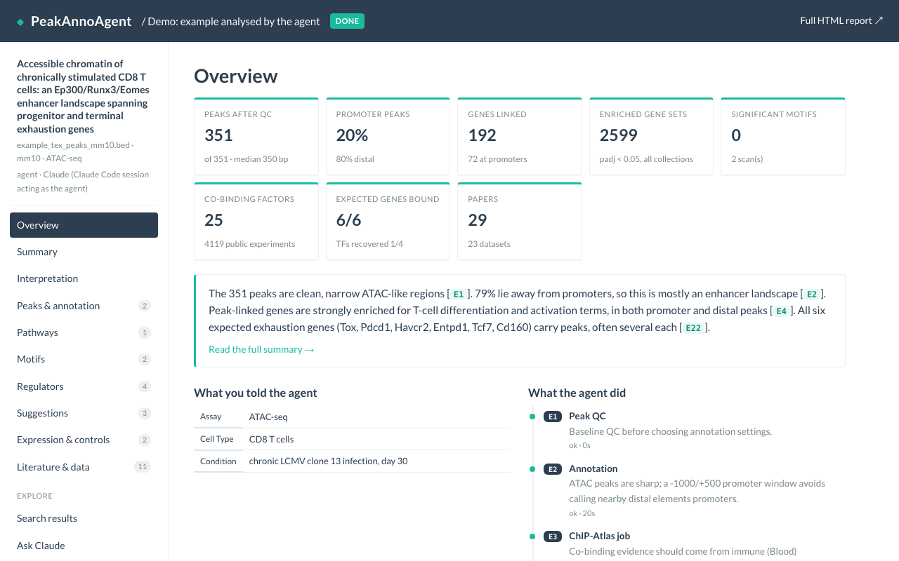<br><sub><b>Overview.</b> Key numbers, the lead of the summary, and what the agent did and why.</sub></td>
  </tr>
  <tr>
    <td width="50%">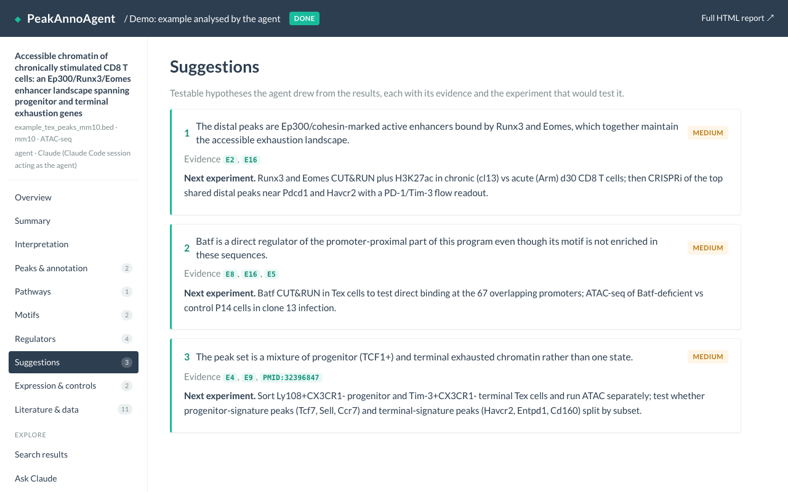<br><sub><b>Suggestions.</b> Each with confidence, evidence badges and a next experiment.</sub></td>
    <td width="50%">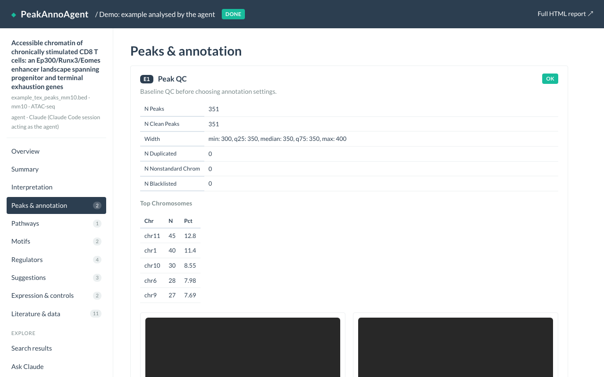<br><sub><b>Result cards.</b> Statistics, figures and tables per step.</sub></td>
  </tr>
  <tr>
    <td width="50%">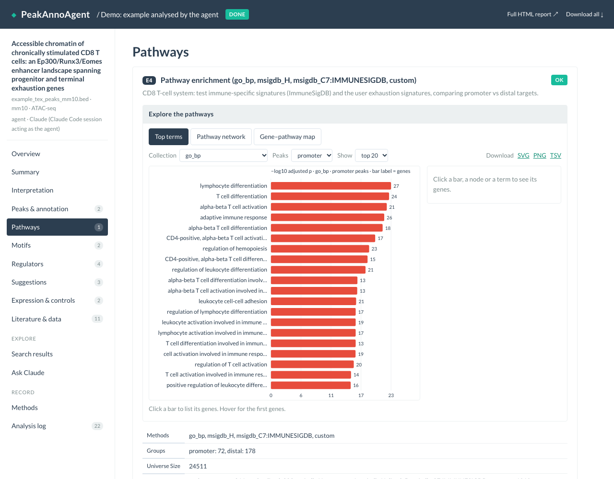<br><sub><b>Pathway explorer.</b> Clickable top terms, a draggable pathway network and a gene–pathway map; click a pathway for its genes, a gene for its pathways. Downloads as SVG, PNG or TSV.</sub></td>
    <td width="50%">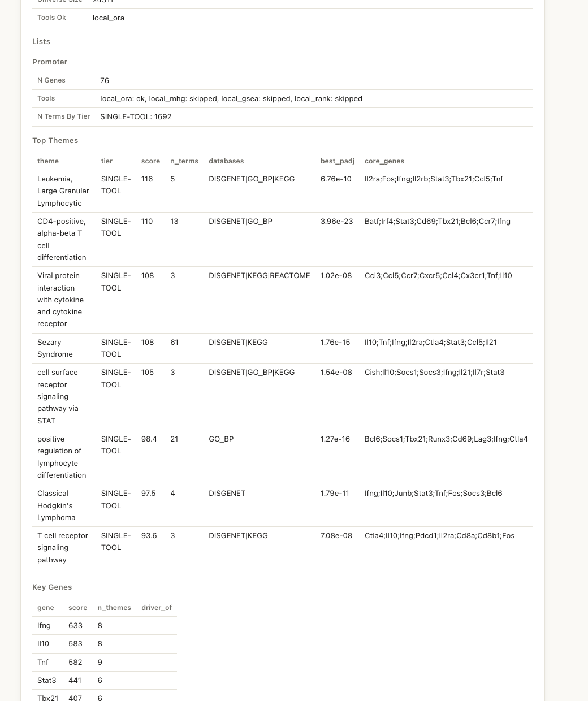<br><sub><b>Pathway consensus.</b> PathwayAgent themes, tiers and key genes per gene list.</sub></td>
  </tr>
  <tr>
    <td width="50%">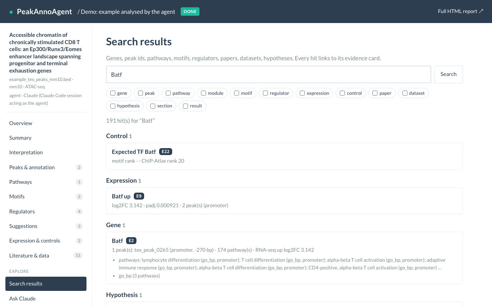<br><sub><b>Search.</b> "Batf" across controls, expression, genes, hypotheses and motifs.</sub></td>
    <td width="50%">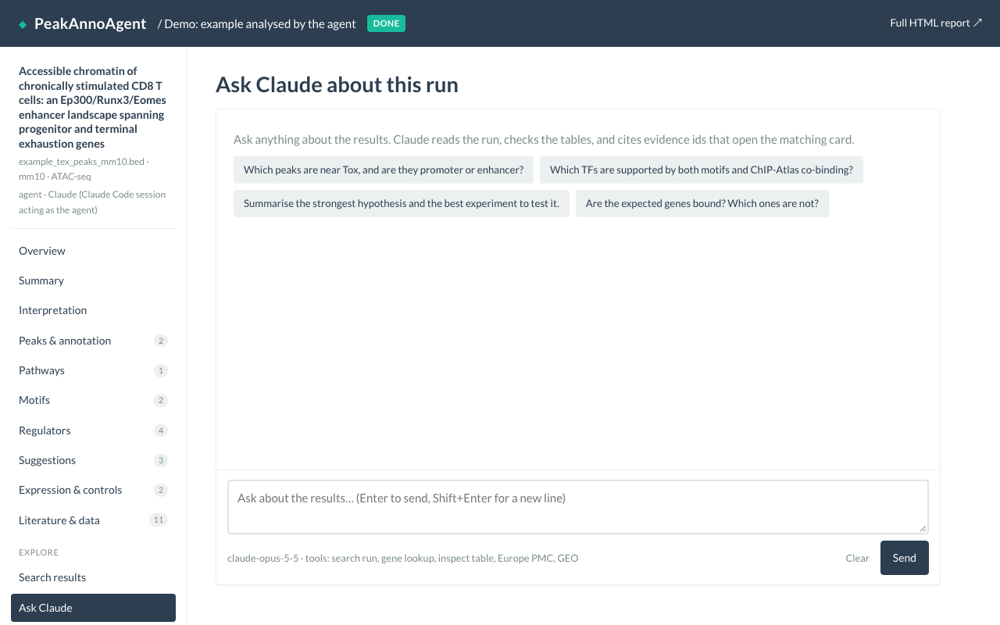<br><sub><b>Ask.</b> Questions about the run, answered with cited evidence.</sub></td>
  </tr>
</table>

### Choose a mode

| Mode | Command | Needs |
|---|---|---|
| **Web app**: form, live log, report, search, chat | `peakanno-agent web` | Flask; `ANTHROPIC_API_KEY` for agent mode and chat |
| **Agent**: Claude plans, runs tools and interprets | `peakanno-agent run …` | `ANTHROPIC_API_KEY` |
| **Deterministic**: fixed plan with a factual summary | `peakanno-agent run … --no-llm` | nothing |
| **Offline**: no ChIP-Atlas, Europe PMC or GEO calls | add `--offline` | nothing |
| **Claude Code / Desktop as the agent** | `claude mcp add peakanno -- python -m peakannoagent.mcp_server` | MCP |

### Use the R engine directly

Every agent tool is also an R function:

```r
library(PeakAnnoAgent)

anno <- run_agent_tool("annotate_peaks", list(
  peaks = "peaks.bed", genome = "mm10", out_dir = "results/r", prefix = "tex"))

enr <- run_agent_tool("enrich_pathways", list(
  gene_sets = anno$gene_sets, universe = anno$universe, genome = "mm10",
  methods = c("go_bp", "msigdb_H"), out_dir = "results/r", prefix = "tex"))

mot <- run_agent_tool("find_motifs", list(
  peaks = "peaks.bed", genome = "mm10", out_dir = "results/r", prefix = "tex"))

enr$pathway_modules$go_bp     # pathway modules from the enrichment map
```

Individual steps also run from the command line (`Rscript scripts/peak_agent.R --help`); see the
[R command-line reference](docs/r_cli.md).

## Example output

These figures come from the bundled example, analysed by the agent. The pathway analysis is deterministic, so the same methods give the same figures.

<table>
  <tr>
    <td width="50%">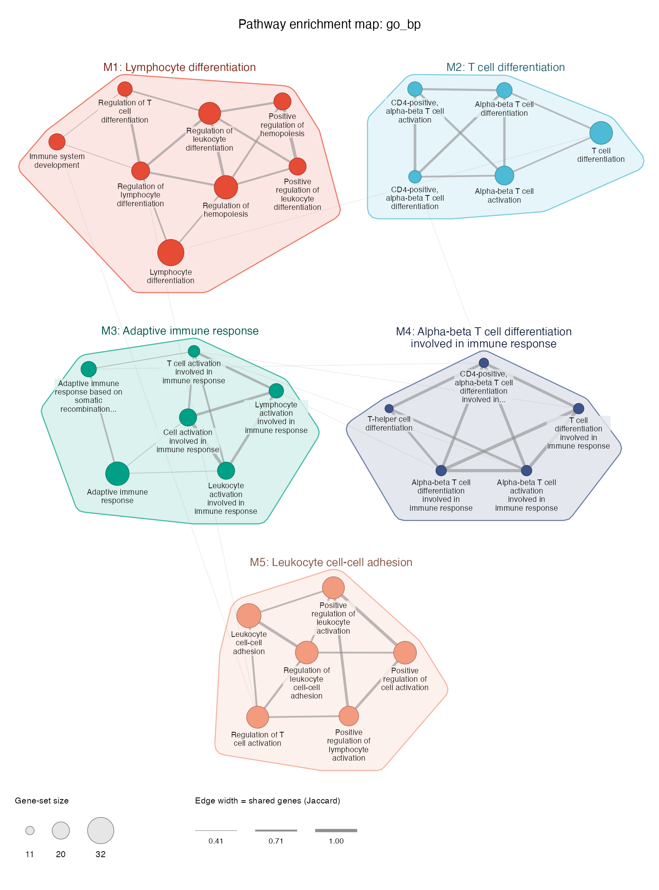<br>
      <sub><b>Pathway enrichment map.</b> GO terms are linked by shared genes and grouped into labelled modules (M1–M5), each laid out on its own as in Cytoscape AutoAnnotate.</sub></td>
    <td width="50%">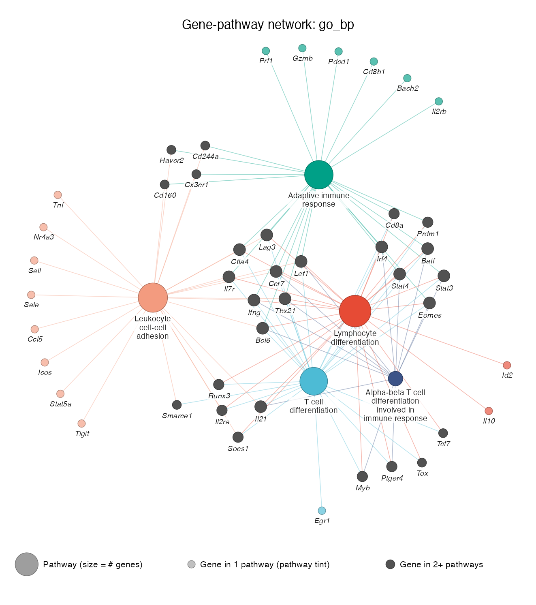<br>
      <sub><b>Gene–pathway network.</b> Module-lead pathways and their genes; genes shared by several pathways are hubs.</sub></td>
  </tr>
  <tr>
    <td>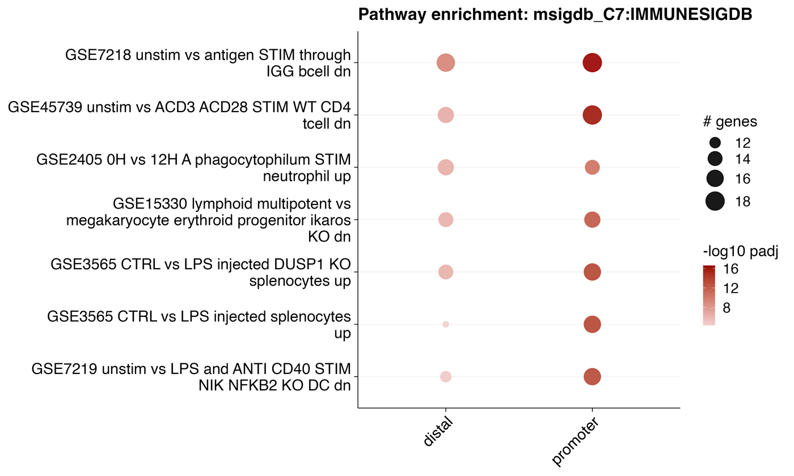<br>
      <sub><b>Signature enrichment</b> (MSigDB ImmuneSigDB) in promoter vs distal peaks.</sub></td>
    <td>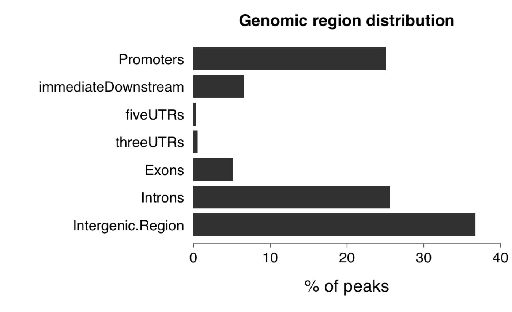<br>
      <sub><b>Genomic distribution</b> of peaks (ChIPpeakAnno).</sub></td>
  </tr>
</table>

Each run writes:

| Output | Content |
|---|---|
| `<prefix>_report.html` | Self-contained report: summary, hypotheses, interpretation, every result with figures and tables, genome browser, references, Methods, analysis log |
| `results/*.pdf` | Every figure as a publication-ready vector PDF |
| `results/*.tsv` | Every table (annotation, enrichment, network nodes and edges, motifs, ChIP-Atlas, RNA-seq overlap) |
| `<prefix>_evidence.json` | Every tool result with its evidence ID, papers and datasets |
| `<prefix>_manifest.json` | Parameters, timing, model usage, unverified citations |

## How it works

```text
           peaks + genome + known biology
                          │
                ┌─────────▼─────────┐        Claude plans the analysis, chooses
                │  Python agent     │◄──────  settings, and interprets results
                │  (agent/)         │        (or a fixed plan with --no-llm)
                └──┬──────────┬─────┘
       JSON bridge │          │ HTTPS
     ┌─────────────▼───┐   ┌──▼──────────────────────────────┐
     │ R engine (R/)   │   │ ChIP-Atlas · Europe PMC · GEO    │
     │ QC, ChIPpeakAnno│   └─────────────────────────────────┘
     │ enrichment,     │
     │ networks, motifs│
     └────────┬────────┘
              ▼
   evidence store (E1, E2, …) ──► HTML report with checked citations
```

**Why you can trust the report**

- **Statistics come only from the tools.** The model never computes them.
- **Citations are checked.** Every tool result gets an evidence ID (`E1`, `E2`, …). The report may cite
  only those IDs, and PMIDs or accessions actually retrieved in this run. Any other citation is sent back
  to the model once, and if it remains it is struck through in the report.
- **Inputs stay data.** Your notes, paper abstracts and GEO text are passed as data, never as
  instructions.
- **Failures are reported, not hidden.** A failed or skipped step appears in the report with its error,
  and the run continues.

## Supported genomes

`mm10`, `mm39`, `hg38` and `hg19` (`mouse` and `human` also work). You can use another annotation
database by setting `--txdb` and `--orgdb` in the R command line.

## Documentation

- [Tutorial website](docs/site/): installation, tool usage, outputs and five step-by-step tutorials
  (Sphinx, Read the Docs theme). Build it with
  `pip install -r docs/site/requirements.txt && sphinx-build -b html docs/site docs/site/_build/html`;
  Build it locally with the instructions in the documentation installation guide
- [Agent guide](agent/README.md): modes, outputs, guardrails, MCP setup
- [Methods](docs/methods.md): statistical methods and the reporting standard
- [Agent design](docs/agent_design.md): architecture and tool contracts
- [R command-line reference](docs/r_cli.md): every R step as a standalone command
- [Vignette](vignettes/peak-annotation-workflow.Rmd): R workflow walkthrough

## Run completion and reproducibility

Reports explicitly distinguish `success`, `partial`, and `failed`, with CLI exits 0, 3, and 1
respectively; invalid invocations return 2. QC and annotation must succeed; pathways,
assay-appropriate motifs, and supplied RNA-seq integration are also required for complete analysis.
Unavailable optional tools are recorded as skipped.

BED and `Chr/Start/End` TSV inputs use **zero-based, half-open** coordinates. Version 1.0.2 corrects
coordinate conversion and blacklist boundaries; re-run older analyses before quantitative use.
Manifests record input SHA-256 hashes and software versions. Use `peakanno-agent check --offline`
to verify local dependencies. See the [release guide](docs/release_1.0.2.md) for release details and local environment setup.

## License and contact

PeakAnnoAgent is released under the [MIT License](LICENSE.md), © 2026 Hua Huang.

**Author and maintainer:** Hua Huang, University of Pennsylvania.
Contact: [helenhuang.math@gmail.com](mailto:helenhuang.math@gmail.com). Bug reports and feature
requests: [GitHub issues](https://github.com/helenhuangmath/PeakAnnoAgent/issues).
Current release: **v1.0.2** (see [CHANGELOG.md](CHANGELOG.md) and the [release validation guide](docs/release_1.0.2.md)).

PeakAnnoAgent depends on many open-source Bioconductor and CRAN packages, and on public resources
(ChIP-Atlas, Europe PMC, NCBI GEO, JASPAR, MSigDB). Each has its own license and terms of use. MSigDB
gene sets in particular are under their own license from the Broad Institute and UC San Diego.
